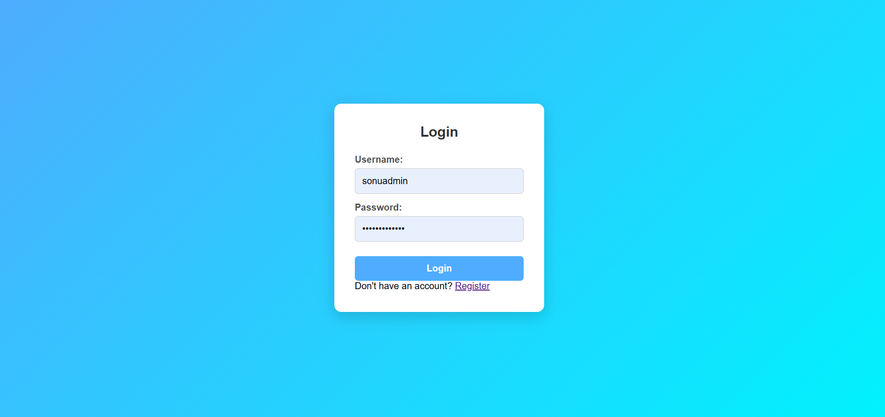
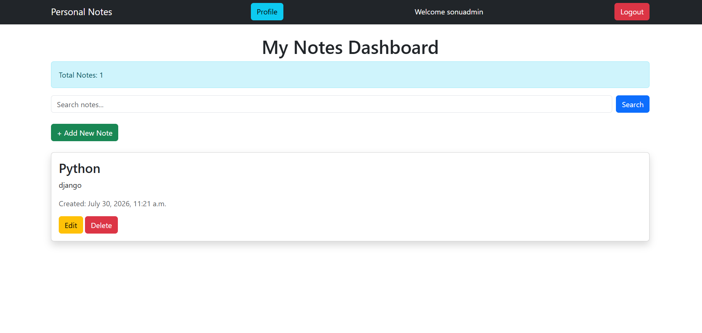
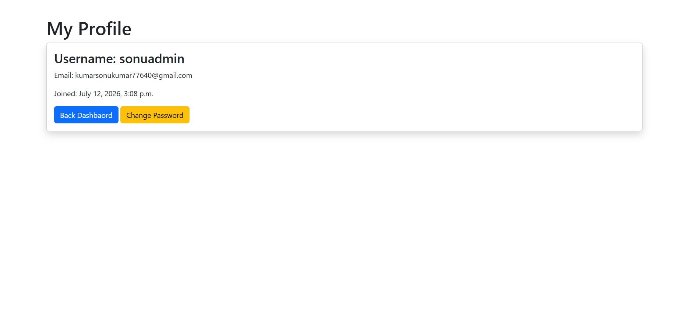
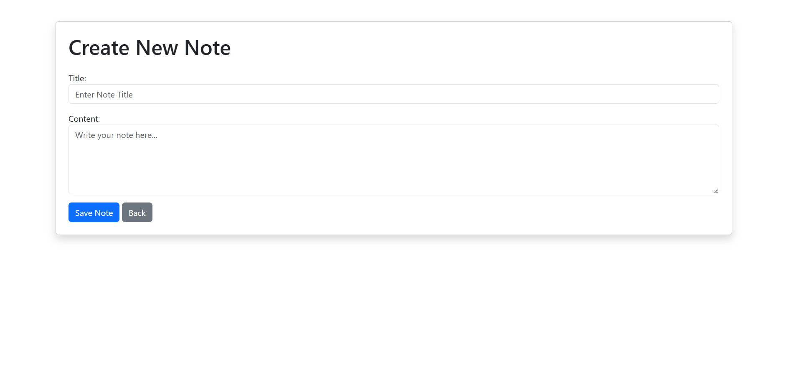
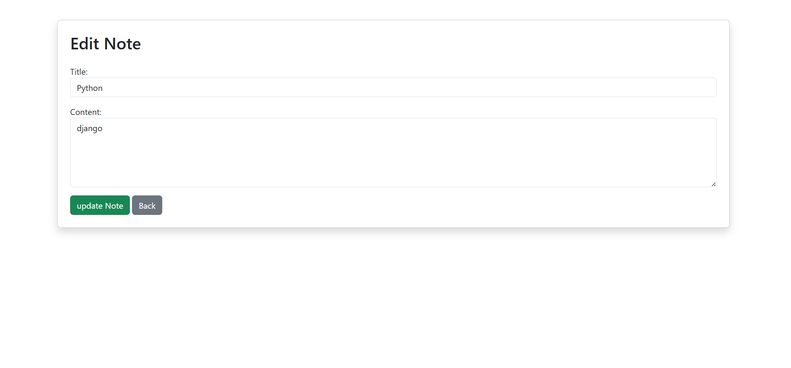
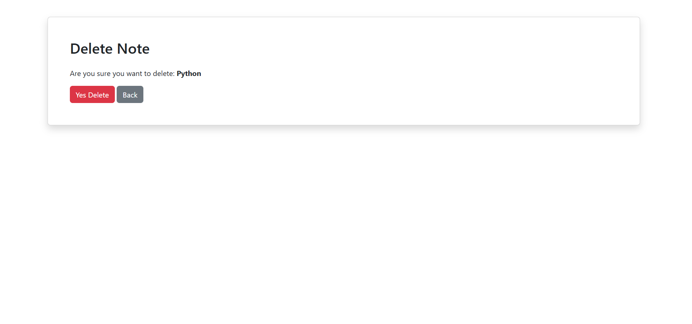

# 📝 Personal Notes App

ek secure Django based Personal notes application banaya hai jaahan user register, login kar sakta hai aur apana personal notes create, read, update, delete kar sakta hai.

## 🚀 Features

- User Registration & Login
- Secure Authentication
- Create Notes
- View Notes
- Update Notes
- Delete Notes
- Search Notes
- User Profile Management
- Change Password
- Pagination
- Responsive Bootstrap UI

## 🛠️ Technologies Used

- Python
- Django
- SQLite (Development)
- PostgreSQL (Production - Render)
- HTML5
- CSS3
- Bootstrap 5
- WhiteNoise
- Gunicorn

## 📸 Screenshots

## Login Page

## Dashboard

## Profile

## Add Note

## Edit Note

## Delete Note

## 🌐 Live Demo

-Live Application: https://personal-notes-project-1.onrender.com

## 👨‍💻 Author

Sonu Kumar